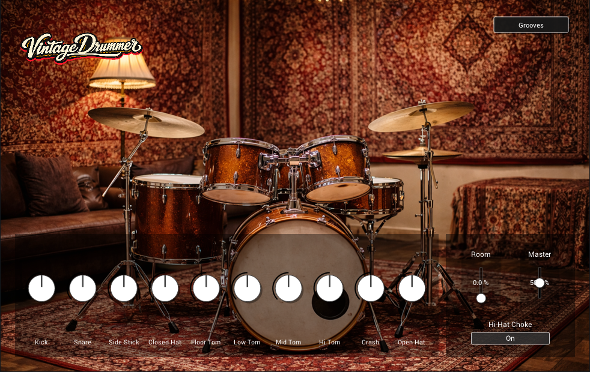

# 🥁 VintageDrummer by Zalex

**VintageDrummer** is an acoustic drum VST3 instrument focused on a warm studio-style drum sound.

VintageDrummer Interface  

## ✨ Features
- Acoustic drum kit with built-in samples
- Per-drum volume controls (Kick, Snare, Side Stick, Toms, Hats, Crash)
- Room and Master controls
- Built-in MIDI grooves
- Hi-Hat choke behavior for more realistic performance

## 🖥️ Platform Support
### Officially supported
- **Windows** — native **VST3** build

### Notes about Linux
- This repository currently distributes a **Windows VST3** build.
- A **native Linux build is not currently provided** by this repository.
- The Windows build may work in some Linux setups via **Wine** or similar compatibility layers, but that is **not an official native-platform guarantee**.

## 🚀 Installation (VST3)
1. Download the official release archive from **Releases**.
2. Place `VintageDrummer.vst3` into your DAW's VST3 plug-in directory.
3. Rescan plug-ins in your DAW.

## 📦 Distribution Scope
Official releases are intended to be distributed as a **complete package**, not as isolated extracted assets.

A release package that contains embedded project assets should include at least:
- `VintageDrummer.vst3`
- `LICENSE`
- `LICENSES/ASSETS_LICENSE.md`
- `THIRD_PARTY_NOTICES.md`
- `LICENSES/APACHE-2.0.txt` (when the embedded Roboto font is included)

## 📄 License Summary
| Component | License |
|---|---|
| Source code | MIT (`LICENSE`) |
| Project samples, MIDI grooves, artwork, logos, screenshots | Custom project asset license (`LICENSES/ASSETS_LICENSE.md`) |
| Third-party notices | `THIRD_PARTY_NOTICES.md` |
| Roboto font text | Apache License 2.0 (`LICENSES/APACHE-2.0.txt`) |

**Important:** GitHub may display **MIT** for the repository because the root `LICENSE` file covers the source code. Non-code assets in this repository are **not** under MIT unless a file explicitly says otherwise.

## ✅ What users may do
- Use the plug-in in personal or commercial music production
- Release rendered audio made with the plug-in
- Fork and modify the **code** under the MIT license

## 🚫 What users may not do with project assets
Unless a separate written permission says otherwise, you may **not**:
- redistribute extracted raw samples, MIDI files, logos, screenshots, or other non-code assets as a standalone pack;
- resell or repackage the project assets as samples, one-shots, loops, MIDI packs, preset packs, or training datasets;
- claim authorship or ownership of the project assets.

## 🔎 Third-Party Components
This project includes or depends on third-party components. Their own licenses and notices apply. See:
- `THIRD_PARTY_NOTICES.md`

## ™ Trademark Note
The terms **VST** and **VST3** are used in this repository descriptively to identify plug-in format compatibility. No Steinberg endorsement is claimed. If you use Steinberg's **VST** trademark or logo in packaging, documentation, websites, or other marketing material, follow Steinberg's usage guidelines.

---
Created by Zalex

## Build from source

See [BUILDING.md](BUILDING.md) for the pinned iPlug2/VST3 SDK setup, Windows x64 Visual Studio/CMake build, generated project, resource checks and CI limitations.
